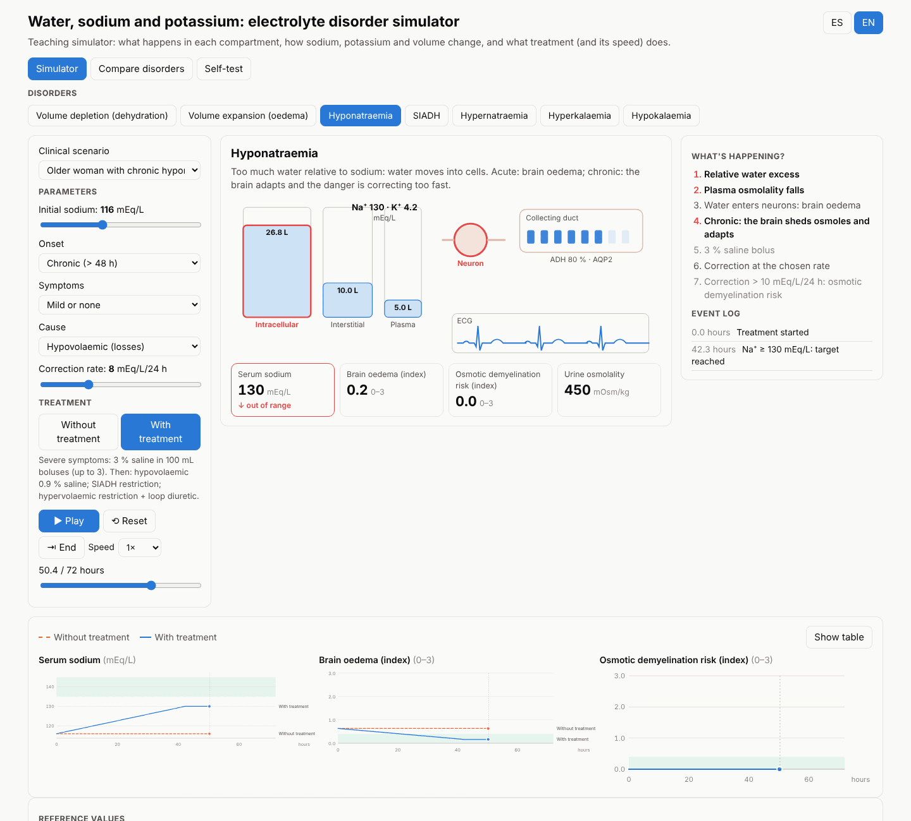

# Water, sodium and potassium disorders

**Alteraciones hidroelectrolíticas: agua, sodio y potasio** — interactive teaching simulator (Spanish / English).

**Live demo:** https://ferasmed-dev.github.io/electrolyte-disorders/ · English: https://ferasmed-dev.github.io/electrolyte-disorders/?lang=en



One shared picture of the body-water compartments (intracellular, interstitial, plasma), a neuron that swells or shrinks with osmolality, the collecting duct with ADH-driven aquaporin-2 channels and a live ECG beat drawn from serum K⁺. Students pick a disorder, move its parameters and compare the course with and without treatment — including what happens when hyponatraemia is corrected too fast.

## What it shows

| Disorder | Time axis | Parameters | Treatment arm |
|---|---|---|---|
| Volume depletion | hours | isotonic losses (L/day), hour saline starts | 0.9 % saline |
| Volume expansion (oedema) | days | cause (HF, cirrhosis, nephrotic), salt intake | salt restriction + loop diuretic |
| Hyponatraemia | hours | initial Na, acute / chronic, symptoms, cause, correction rate | 3 % saline boluses if severe, then cause-specific correction at the chosen rate |
| SIADH | days | water intake, fluid restriction or tolvaptan | restriction / tolvaptan |
| Hypernatraemia | hours | cause (extrarenal loss, central DI, nephrogenic DI, hypertonic load), initial Na | free water ± desmopressin / thiazide |
| Hyperkalaemia | hours | initial K, cause | calcium → insulin + β2 → binders / dialysis |
| Hypokalaemia | days | initial K, cause, oral or IV route | K⁺ replacement |

Every entity offers:

- a **schematic** that shows the mechanism live and highlights where the disorder acts;
- **sliders and choices** for the parameters that drive it;
- a **sin / con tratamiento** (without / with treatment) comparison drawn on the same chart (dashed = without, solid = with);
- a **"¿Qué está pasando?"** panel that lights up each step of the mechanism as it happens, plus an **event log**;
- gauges with reference ranges, a **data-table view** of every chart, a **compare** tab with all entities side by side and a **self-test** tab.

## Curriculum fit

For students and teachers at any Spanish medical faculty.

- **Module (Orden ECI/332/2008):** Módulo III, *Formación clínica humana* (with support from Módulo II for physiology and pathology).
- **Typical subjects:** Fisiología, Fisiopatología, Patología médica / Nefrología, Medicina de urgencias.
- **MIR:** high-yield every year (hyponatraemia work-up and correction speed, SIADH criteria, hyperkalaemia ECG and treatment order).

## For teachers

Every scenario has a deep link you can project or share. Add `&lang=en` for English.

| Preset | Scenario (EN) | Expected result | Link |
|---|---|---|---|
| `gastroenteritis` | Gastroenteritis with vomiting and diarrhoea | ECF 15 → 8 L, SBP 120 → 66 mmHg without saline; held at 120 with saline from hour 6 | [ES](https://ferasmed-dev.github.io/electrolyte-disorders/?preset=gastroenteritis) · [EN](https://ferasmed-dev.github.io/electrolyte-disorders/?preset=gastroenteritis&lang=en) |
| `ic_descompensada` | Heart failure on a high-salt diet | ECF 15.5 → 23 L with Na 139 → 132; restriction + loop diuretic keep ECF ~15.5 L | [ES](https://ferasmed-dev.github.io/electrolyte-disorders/?preset=ic_descompensada) · [EN](https://ferasmed-dev.github.io/electrolyte-disorders/?preset=ic_descompensada&lang=en) |
| `hipona_cronica_anciana` | Older woman with chronic hyponatraemia | Na 116 → 130 at 8 mEq/L/24 h (~42 h) with no demyelination risk | [ES](https://ferasmed-dev.github.io/electrolyte-disorders/?preset=hipona_cronica_anciana) · [EN](https://ferasmed-dev.github.io/electrolyte-disorders/?preset=hipona_cronica_anciana&lang=en) |
| `sobrecorreccion` | Chronic hyponatraemia corrected too fast | Rise > 10 mEq/L in 24 h at hour 15: demyelination index reaches 3 | [ES](https://ferasmed-dev.github.io/electrolyte-disorders/?preset=sobrecorreccion) · [EN](https://ferasmed-dev.github.io/electrolyte-disorders/?preset=sobrecorreccion&lang=en) |
| `maraton` | Confused marathon runner | Acute: brain-oedema index 1.9 → 2.5 untreated; three 3 % boluses in the first hour, Na 130 by hour 17 | [ES](https://ferasmed-dev.github.io/electrolyte-disorders/?preset=maraton) · [EN](https://ferasmed-dev.github.io/electrolyte-disorders/?preset=maraton&lang=en) |
| `siadh_pulmon` | SIADH from lung cancer | Na 136 → 131 untreated; fluid restriction keeps it at 136 | [ES](https://ferasmed-dev.github.io/electrolyte-disorders/?preset=siadh_pulmon) · [EN](https://ferasmed-dev.github.io/electrolyte-disorders/?preset=siadh_pulmon&lang=en) |
| `siadh_tolvaptan` | SIADH treated with tolvaptan | Na 136 → 128 untreated vs 138 with tolvaptan; uOsm 520 → 180 | [ES](https://ferasmed-dev.github.io/electrolyte-disorders/?preset=siadh_tolvaptan) · [EN](https://ferasmed-dev.github.io/electrolyte-disorders/?preset=siadh_tolvaptan&lang=en) |
| `di_central` | Central diabetes insipidus after head injury | Na 158 → 164 untreated; free water + desmopressin: Na 142, urine output 8 → 2 L/day | [ES](https://ferasmed-dev.github.io/electrolyte-disorders/?preset=di_central) · [EN](https://ferasmed-dev.github.io/electrolyte-disorders/?preset=di_central&lang=en) |
| `anciano_sin_acceso` | Bed-bound older patient without water access | Na 162 → 168 untreated; free water brings it to 142 by ~41 h | [ES](https://ferasmed-dev.github.io/electrolyte-disorders/?preset=anciano_sin_acceso) · [EN](https://ferasmed-dev.github.io/electrolyte-disorders/?preset=anciano_sin_acceso&lang=en) |
| `hiperk_erc` | CKD with K⁺ 7.4 | K 7.4 → 4.3: calcium at 3 min, insulin + β2 at 12 min, binders / dialysis from 1 h | [ES](https://ferasmed-dev.github.io/electrolyte-disorders/?preset=hiperk_erc) · [EN](https://ferasmed-dev.github.io/electrolyte-disorders/?preset=hiperk_erc&lang=en) |
| `hiperk_ieca` | ACEi-induced hyperkalaemia | K 6.3 → 4.1 with treatment; 6.5 without | [ES](https://ferasmed-dev.github.io/electrolyte-disorders/?preset=hiperk_ieca) · [EN](https://ferasmed-dev.github.io/electrolyte-disorders/?preset=hiperk_ieca&lang=en) |
| `hipok_diureticos` | Diuretic-induced hypokalaemia | K 2.6 → 1.8 untreated; oral replacement → 4.3 (in range by day 3) | [ES](https://ferasmed-dev.github.io/electrolyte-disorders/?preset=hipok_diureticos) · [EN](https://ferasmed-dev.github.io/electrolyte-disorders/?preset=hipok_diureticos&lang=en) |
| `hipok_grave_iv` | Severe hypokalaemia from diarrhoea | K 2.0 → 4.3 with IV replacement (in range by day 2.4) | [ES](https://ferasmed-dev.github.io/electrolyte-disorders/?preset=hipok_grave_iv) · [EN](https://ferasmed-dev.github.io/electrolyte-disorders/?preset=hipok_grave_iv&lang=en) |

You can also open a single entity with `?entity=<key>` (keys are listed in `src/model.js`).

## Model

Each disorder is an explicit time-step model (`runner()` in `src/model.js`) over compartments: intracellular (25 L), extracellular (15 L: ⅔ interstitial, ⅓ plasma), serum Na⁺ and K⁺, ADH (0–1) and derived gauges.

- **Plasma osmolality** = 2·Na + glucose/18 + urea/6 (≈ 290 at Na 140).
- **Volume depletion:** isotonic losses shrink the ECF with Na unchanged; systolic BP and GFR fall with ECF (pre-renal); saline replaces the deficit.
- **Hyponatraemia:** acute (< 48 h) → a brain-oedema index that grows while Na keeps falling; chronic → adapted brain (low oedema) but a demyelination index that rises when the 24-h rise exceeds 10 mEq/L. Severe symptoms trigger up to three 100-mL boluses of 3 % saline (~4 mEq/L in the first 1.5 h), then correction at the chosen rate to 130 mEq/L.
- **SIADH:** ADH fixed high; serum Na falls with water intake; uOsm > 100, uNa > 30, urate < 4. Restriction (≤ 1 L/day) or tolvaptan (aquaresis, uOsm falls) raises Na.
- **Hypernatraemia:** water deficit raises Na; DI gives polyuria with dilute urine; free water lowers Na by ~10 mEq/L/day; desmopressin corrects central DI, thiazide partly reduces nephrogenic DI polyuria.
- **Hyperkalaemia:** an arrhythmic-risk index from K (T waves > 5.5, QRS widening > 6.5); calcium cuts the risk within minutes without lowering K; insulin + β2 shift K into cells from 0.2 h; binders / dialysis remove it from 1 h.
- **Hypokalaemia:** ~300 mEq total-body deficit per 1 mEq/L fall (Model); oral 120 mEq/day vs IV 240 mEq/day.

**Model** tag: constants marked "Model" in `src/model.js` are teaching assumptions tuned so each preset reproduces the textbook course; they are not fitted to patient data.

### Parameters

| Parameter | Range (default) | Basis |
|---|---|---|
| Isotonic losses | 1–8 L/day (4); saline from hour 2–24 (8) | Model |
| Initial Na (hyponatraemia) | 105–134 mEq/L (118) | < 125 severe, < 120 very severe |
| Correction rate | 4–18 mEq/L/24 h (8) | 6–8 recommended, never > 10 (ERBP/ESE 2014) |
| Water intake (SIADH) | 1–4 L/day (2.5) | restriction ≤ 1 L/day |
| Initial Na (hypernatraemia) | 148–175 mEq/L (160) | correct over ~48 h |
| Initial K (hyperK) | 5.6–8.5 mEq/L (7.2) | ECG changes > 6–6.5 |
| Initial K (hypoK) | 1.8–3.4 mEq/L (2.6) | < 2.5 severe |
| K replacement | oral 120 / IV 240 mEq/day | oral 100–150 mEq/day; IV ≤ 10–20 mEq/h |

### Known simplifications

- Compartments are lumped; no separate red-cell or transcellular water.
- Osmotic demyelination and brain oedema are 0–3 indices, not probabilities.
- Hyperkalaemia treatment doses are fixed; only the order and timing of their effects is modelled.
- Sodium-glucose interactions (pseudo- and hyperglycaemic hyponatraemia) are not modelled.

### Content beyond the core notes

- Osmotic demyelination threshold (> 10 mEq/L in 24 h for chronic hyponatraemia) and the 3 % bolus protocol follow the European guideline (Spasovski 2014).
- Severe symptomatic hyponatraemia is written as Na < 125 mEq/L; a cutoff written as "105" in some notes is in mOsm/L, not mEq/L.
- Hyperkalaemia treatment order follows the UK Renal Association / KDIGO consensus; atrial fibrillation is listed as supraventricular, not ventricular, among hypokalaemia arrhythmias.

## Layout

```
index.html
src/model.js       pure model: entities, gauges, presets, simulate()
src/i18n.js        ES + EN strings (events are factories, so a language switch re-renders them)
src/ui.js          DOM, animation loop, explanations; exposes window.__sim for automated checks
src/schematic.js   SVG schematic of the mechanism, redrawn every frame
src/charts.js      dependency-free SVG line charts with hover tooltips and table view
src/styles.css     light/dark via prefers-color-scheme, responsive
tests/model.test.js
curriculum.json    topic metadata
```

## Run locally

```bash
python3 -m http.server 8000
# open http://localhost:8000/
```

No build step, no dependencies.

## Tests

```bash
npm test        # node --test (Node 18+)
```

The tests cover well-formed output for every entity at default and extreme parameters (finite, non-negative, valid steps), purity, i18n completeness in both languages, every preset, and the key mechanism of each entity (direction of each effect and the treatment comparison). GitHub Actions runs them on every push.

## Deploy (GitHub Pages)

Settings → Pages → *Deploy from a branch* → `main` / `(root)`. The site is served at https://ferasmed-dev.github.io/electrolyte-disorders/.

## References

- Spasovski G, et al. Clinical practice guideline on diagnosis and treatment of hyponatraemia. *Eur J Endocrinol* 2014;170:G1–47.
- Adrogué HJ, Madias NE. Hyponatremia; Hypernatremia. *N Engl J Med* 2000;342:1581–9 and 1493–9.
- Palmer BF, Clegg DJ. Physiology and pathophysiology of potassium homeostasis. *Adv Physiol Educ* 2016;40:480–90.
- KDIGO Controversies Conference: potassium homeostasis and management of dyskalaemia. *Kidney Int* 2020;97:42–61.
- Rose BD, Post TW. *Clinical Physiology of Acid-Base and Electrolyte Disorders*, 5th ed.

---

Herramienta docente · no apta para uso clínico — Teaching tool · not for clinical use. MIT licence © 2026 Feras Elhissi.
